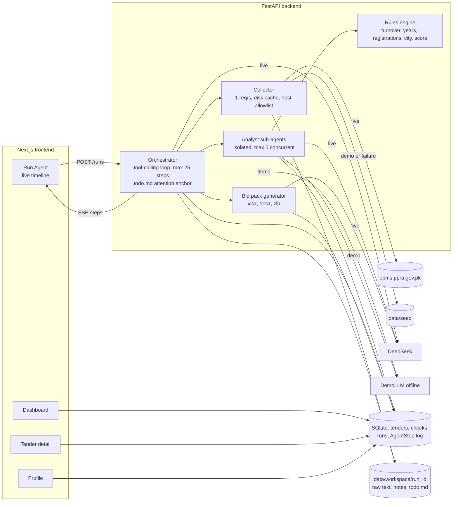

# TenderScout

An AI agent that finds Pakistani government IT tenders (PPRA / e-PADS), scores how well each fits your
company, checks eligibility clause by clause, and generates a bid pack.



## Setup

You need [uv](https://docs.astral.sh/uv/) and Node 20+. uv installs Python 3.11.

```bash
cp .env.example .env              # add DEEPSEEK_API_KEY (API_KEY also works)
make install
make seed                         # loads 12 sample tenders and analyses them offline
make dev                          # API on :8010, web on :3010
```

Open http://localhost:3010. To use other ports: `make dev API_PORT=8000 WEB_PORT=3000`.

| Command | What it does |
|---|---|
| `make dev` | Runs the backend and frontend |
| `make test` | Backend tests and the frontend type check |
| `make seed` | Resets the seed tenders with fresh dates |
| `make eval` | Runs the seed tenders through real DeepSeek and prints metrics. `make eval DEMO=1` runs offline. |

## How it works

**Agent loop.** The model picks a tool, the backend runs it, and a short observation goes back. The tools
are `fetch_tender_listings`, `download_document`, `extract_text`, `analyze_many`, `generate_bid_pack` and
`write_note`. Every call also rewrites `todo.md`, and only the latest version stays in context.

**Scoring.** Capability match is 40%, eligibility 40% and value fit 20%. A failed mandatory clause caps the
score at 20. Strong is 70 or more, partial is 30 to 69, and non-fit is under 30.

**Deterministic where possible.** Python checks turnover, years in business, registrations and city. The
LLM reads documents, judges fuzzy clauses such as "similar experience", and drafts proposal prose.
Scores and costs are computed in code.

**Context engineering**

| Rule | Implementation |
|---|---|
| Offload | Raw text stays in `data/workspace/<run_id>/`. Results over ~2k tokens go to a file, leaving a path and preview. |
| Isolate | Each tender gets its own sub-agent, which sees only its document and the profile. |
| Reduce | Long documents are split, chunks with no criteria are skipped, and the rest are summarised. |
| Validate | LLM output is checked with Pydantic, with one retry. Quotes not found in the document are dropped. |
| Log | Every step is written to `AgentStep`, and the timeline streams from it. |

**Failure handling**

| Failure | Behaviour |
|---|---|
| DeepSeek timeout | Retries with backoff. In a sub-agent, only that tender is marked as an error. In the main loop, the run fails with a clear message. |
| Invalid JSON | One retry with the validation error, then the tender is marked as an error |
| Scanned PDF | Marked "Needs OCR" and not scored |
| Empty or corrupt PDF | Marked "No document" and not scored |
| PPRA down or markup changed | Falls back to seed data, and the first timeline step says so |
| Model drafting fails | The bid pack uses a template, so generation still completes |
| Injection in a tender document | Tender text is marked as untrusted data, and downloads and file paths are restricted |

## Eval

`make eval` on the 12 seed tenders with real DeepSeek (`deepseek-chat`), November 2026:

| Metric | Result |
|---|---|
| Fit classification | **11/12 = 92%** (strong 4/4, partial 3/4, non-fit 4/4) |
| Avg latency per tender | 4.6 s (13.9 s for all 12 at 5 concurrent) |
| Total tokens | 31,546 |
| Estimated cost | $0.015 at $0.27/M input and $1.10/M output. Check these against current pricing. |

**What these numbers mean.** The seed tenders are short and synthetic, so this measures the pipeline, not
accuracy on real tenders. Real PPRA documents run 70 to 115 pages and cost about 50k tokens, about a minute
and about $0.025 each. No labelled set of real tenders exists yet, so real-world accuracy is unmeasured.

**The miss.** SEED-05 says a bidder "should deploy a team of at least 25". The label treats this as
preferred, while DeepSeek consistently reads it as mandatory and disqualifies a 20-person firm. That reading
is defensible, and Pakistani tenders often use "should" for hard requirements, so neither the prompt nor the
label was changed to raise the score.

## 3-minute demo script

**Before you start:** run `make seed && make dev` and turn on **Demo mode** in the sidebar. Demo mode uses
no network, so it cannot fail on stage.

1. **The problem (20 s). Dashboard.** "Small software houses miss government work because finding a tender
   and checking if you qualify takes days. TenderScout does it in minutes."
2. **Start the agent (60 s). Run Agent.** Press **Start** with the default goal. Point out each step
   appearing live, the reasoning under it, and the sub-agents scoring tenders in parallel. "Each tender gets
   its own clean context, so one document can't affect another."
3. **Why a tender was rejected (40 s). Tender detail.** Back on the Dashboard, open **Sindh Municipal
   Services Web Portal**. "It looks perfect: a web portal at a good size. But one clause requires a Karachi
   head office, so the score is capped at 20." Show the ❌ and the quote from the document.
4. **The bid pack (40 s).** Open the top tender from **Goal complete**, and show the generation time.
   Download the zip and open `compliance_checklist.xlsx` (colour coded) and `technical_proposal.docx`.
   "Costs are live Excel formulas, and experience comes only from your real profile."
5. **Close (20 s). Dashboard.** Show the updated KPIs. "With Demo mode off, this same flow reads the live
   PPRA site with DeepSeek."

## Limitations

- Bid packs are drafts. A person must review the costs, the work plan and every "confirm" item before
  submitting.
- The default company profile is sample data: replace its registration numbers and past projects.
- Demo mode's agent is scripted and ignores the goal text. Its results show the pipeline, not model quality.
- Most real PPRA tenders publish no estimated value, so value fit is neutral for them and the cost sheet
  uses a labelled placeholder budget.
- Scanned PDFs are detected but not read: there is no OCR.
- The API has no authentication. See [docs/DEPLOY.md](docs/DEPLOY.md) before exposing it.
